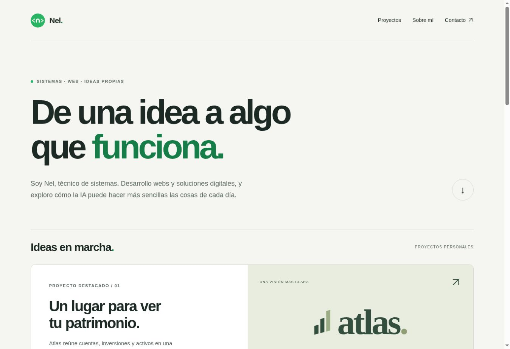

# Nel — Portfolio

Portfolio personal de sistemas y proyectos digitales. Incluye Atlas, Tramo, Platto y los tres proyectos originales: SkullScape, tinyspace y El Estanque Azul.


## Vista previa



## Proyectos incluidos

| Proyecto | Descripción | Demo |
| --- | --- | --- |
| Platto | Carta digital para restaurantes, demo de carnes y bodega, editor y QR permanente. | [Platto](https://platto.nmclabs.dev/) |
| Tramo | Seguimiento de paquetes: presentación, demo y cuenta personal. | [Tramo](https://tramo.nmclabs.dev/) |
| Atlas | Seguimiento privado del patrimonio; presentación pública de la aplicación. | [Atlas](https://atlas.nmclabs.dev/) |
| SkullScape. | Landing de una marca ficticia de auriculares. | [Demo](https://skullscape.nmclabs.dev) |
| tinyspace. | Concepto de web de mobiliario y catálogo. | [Demo](https://tinyspace.nmclabs.dev) |
| El Estanque Azul | Proyecto académico de una granja ficticia. | [Demo](https://estanque.nmclabs.dev) |

## Publicación

- Portfolio: https://nmclabs.dev
- Atlas: https://atlas.nmclabs.dev/ (alojamiento independiente).
- Tramo: https://tramo.nmclabs.dev/ (alojamiento y repositorio independientes).
- Platto: https://platto.nmclabs.dev/ (alojamiento y repositorio independientes). Código en https://github.com/nelmarcoss/Platto.
- Las antiguas rutas `/tramo/*` redirigen al sitio independiente.
- Cada cambio en `main` se publica mediante la conexión existente entre GitHub y Netlify.
- Dominio propio `nmclabs.dev`, con subdominios para cada proyecto y alojamiento en Netlify.

## Desarrollo

El portfolio usa HTML, CSS y JavaScript, sin dependencias de ejecución. Tramo tiene su propio repositorio privado y publicación independiente en Netlify.

```sh
node --check portfolio.js
node build.mjs
```

Netlify usa Node.js 22 y publica únicamente `dist/`. El script de construcción copia solo los archivos públicos necesarios. Las imágenes WebP son versiones optimizadas de los originales conservados en `proyectos/`.

La página del portfolio funciona sin JavaScript; este solo actualiza el año del pie. Tramo, alojado de forma independiente, requiere JavaScript. El tema se adapta a la preferencia del dispositivo. El portfolio no incorpora analítica ni datos financieros de Atlas. Tramo tiene sus propios formularios y sesión. Platto y Tramo comparten la infraestructura de Supabase con tablas y políticas de acceso separadas; las webs y repositorios son independientes. El código de Tramo está en https://github.com/nelmarcoss/Tramo y su documentación está en ese repositorio.

## Estructura

- `index.html`: presentación, proyectos, sobre mí y contacto.
- `estilos.css`: diseño adaptable y temas claro y oscuro.
- `portfolio.js`: actualización del año del pie.
- `proyectos/`: imágenes y recursos visuales.
- `build.mjs`: generación de la carpeta pública `dist/`.
- `netlify.toml`: configuración de construcción y publicación.

## Autor

**Nel** · [LinkedIn](https://www.linkedin.com/in/nelmarcos/) · [Contacto](mailto:nelmarcos@icloud.com)

## Acceso compartido de NMCLabs

`https://nmclabs.dev/cuenta/` es la página neutral de entrada a Platto y Tramo y el destino previsto de respaldo para Supabase Auth. No recibe contraseñas, no interpreta ni reenvía tokens y no añade seguimiento. Los enlaces válidos de confirmación o recuperación siguen las direcciones explícitas de cada aplicación; un enlace inválido o una redirección no autorizada puede caer en esta página común.

Después de publicar esta página, configurar el **Site URL** del Supabase compartido con `https://nmclabs.dev/cuenta/`, conservando todas las **Redirect URLs** válidas de Tramo y Platto. No es necesario cambiar las rutas de las aplicaciones. Las plantillas compartidas de Auth deben tener la marca NMCLabs; los avisos de paquetes de Tramo conservan su propia marca.
