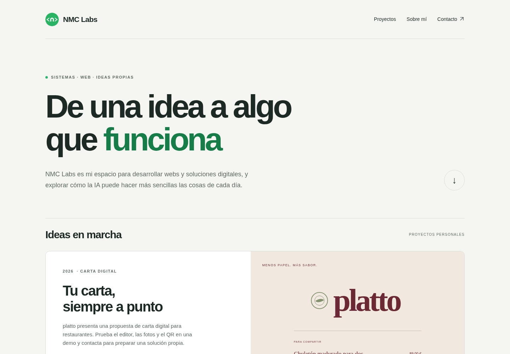
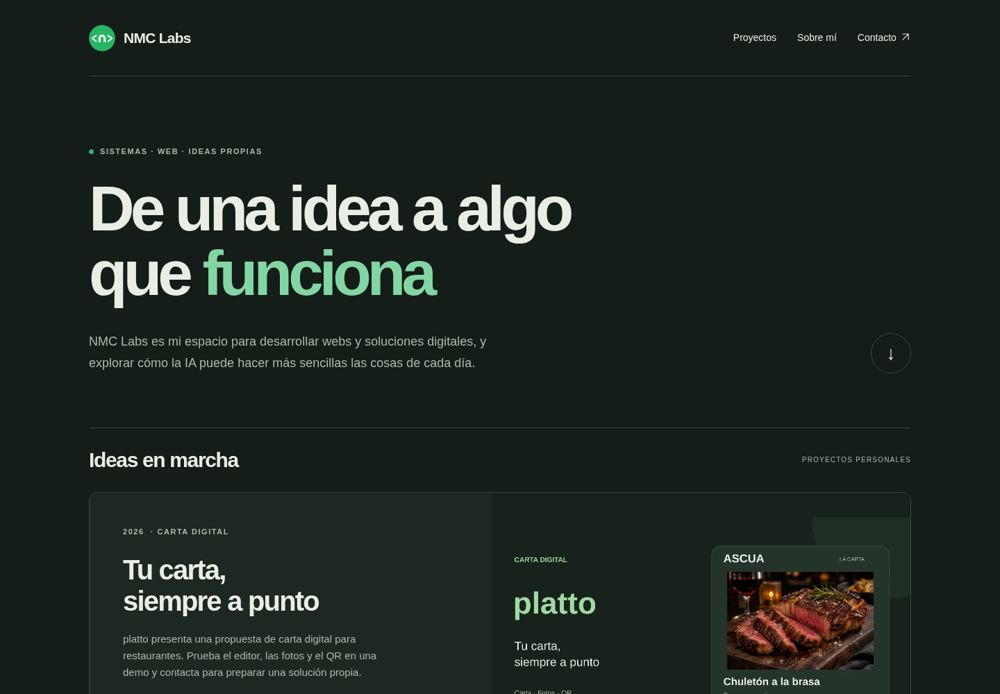

# NMC Labs — Sistemas y proyectos digitales

**Un proyecto de [NMC Labs](https://nmclabs.dev/) · 2026.**

**[Visitar la web](https://nmclabs.dev/) · [NMC Labs](https://nmclabs.dev/)**

## Vista previa

[](https://nmclabs.dev/)

Captura de la versión mantenida en este repositorio.

[](https://nmclabs.dev/)

## Qué es

Mi espacio para desarrollar aplicaciones, explorar ideas y compartir mi evolución desde las primeras webs hasta proyectos propios.

## Qué incluye

- platto, Puntual, amano, atlas y tramo como proyectos destacados, con año y contexto.
- amano: inventario de equipos de empresa, custodia, préstamos, mantenimiento y etiquetas QR en una demo completa.
- Puntual: presentación comercial y demo conectada de reservas y agenda para barberías y peluquerías.
- GTA VI · Cuenta atrás y 29N como herramientas de actualidad. El especial electoral reúne sondeos con fuentes, candidaturas, cuatro elecciones, provincias y pactómetro.
- Originales de SkullScape (2023), tinyspace (2022) y El Estanque Azul (2021).
- La nueva granja, Tinyspace y Skullscape (2026), junto a sus originales y con sus casos de estudio.
- Portadas comerciales de marca, sin puntos decorativos: carta, patrimonio, ruta, agenda, mobiliario, granja, auriculares y actualidad.
- Botones de proyecto unificados: mismo cuadro, color y tamaño en destacados, actualidad y evolución.
- Diseño adaptable, tema automático y navegación por teclado.


## Alcance y límites

Es un portfolio público. No muestra los datos privados de atlas ni de tramo La nueva granja, Tinyspace y Skullscape se pueden visitar; sus repositorios son privados. El contacto abre la aplicación de correo del visitante.

## Tecnología

HTML, CSS y JavaScript sin dependencias de ejecución. Node.js 22 para construir.

## Desarrollo y comprobación

```sh
node --check portfolio.js
node build.mjs
```

La página funciona sin JavaScript; el script solo actualiza el año del pie.

## Publicación

La portada es la única página indexable del portfolio; los casos de evolución conservan sus enlaces y llevan `noindex`. Incluye SEO orgánico: títulos descriptivos, canónicas, vistas previas al compartir, datos estructurados, `robots.txt` y `sitemap.xml`. Las pantallas de cuenta y demos no forman parte del sitemap y llevan `noindex` cuando existen. [Guía de verificación en Search Console](docs/seo.md).

Netlify construye `main` con `node build.mjs` y publica `dist/`. Dominio: https://nmclabs.dev/. Cada aplicación se aloja de forma independiente.

## Estructura

- `index.html`, `estilos.css`, `portfolio.js`: web del portfolio.
- `proyectos/`: portadas y casos de estudio de El Estanque Azul, Tinyspace y Skullscape
- `docs/images/`: capturas para la documentación.
- `build.mjs`, `netlify.toml`: construcción y publicación.

## Autoría

Creado por **Nel**, detrás de [NMC Labs](https://nmclabs.dev/). [Perfil de GitHub](https://github.com/nelmarcoss) · [LinkedIn](https://www.linkedin.com/in/nelmarcos/).

Contacto público: [info@nmclabs.dev](mailto:info@nmclabs.dev).

Las tarjetas de platto, atlas, tramo, GTA VI y 29N explican la idea, el reto y la decisión de diseño de cada proyecto en un desplegable cerrado al entrar.
